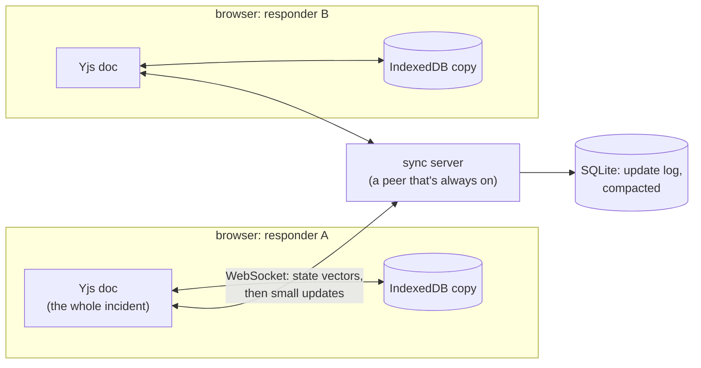

# local-first-notes

Incident notes that keep working offline and merge everyone's edits without conflicts. Each incident is a [Yjs](https://yjs.dev) document, a set of CRDTs (conflict-free replicated data types): every responder's browser holds the whole incident, edits it without waiting for the network, and syncs whenever it can.

TypeScript (run directly by Node 26; type-checked by TypeScript 7.0) · Yjs 13.6 · y-protocols · `ws` · Node's built-in SQLite · Vite 8 · fast-check. Personal learning project, built pairing with Claude Code.

## How it fits together



The server isn't the source of truth: any copy can be edited and merged with any other, in any order, and they all end up the same. That's the CRDT guarantee, and the property test checks it on 500 random histories.

## Try it

```bash
npm install
npm test                      # 16 tests, about 4 s
npm run build && npm start    # then open http://127.0.0.1:8097/incident/inc-demo in two windows
```

Switch one window to "work offline", edit in both, switch back.

## Build log

### Step 1: the incident document and why it always converges

`src/shared/incident.ts` models one incident as a Yjs doc. How the data is nested decides what happens when two people change the same thing at once:

| Part | Yjs type | When two people edit it at the same time |
|---|---|---|
| title, severity, status | `Y.Map` | one value wins, the **same one** on every replica |
| notes | `Y.Text` | both edits kept, interleaved the same way everywhere |
| timeline | `Y.Array` | every entry kept; shown sorted by time, then id |
| action items | `Y.Map` of `Y.Map` | one person ticking "done" and another reassigning: **both** survive, because each field is its own register |

Tests (Node's built-in test runner, running the TypeScript directly; Node 26 strips the types itself, no build step):
- typing in different places and at the same spot; two severities set at once; tick vs reassign; delete vs a concurrent edit (delete wins); three people adding timeline entries offline; the same updates applied twice and in reverse order (no change: merging is idempotent and commutative).
- **A property test** ([fast-check](https://fast-check.dev)): 500 random histories of edits on three replicas, synced in random partial orders, must end with all three identical. It ran in about 0.3 s.

Checking the property test can fail: with the sync made one-way on purpose, it failed at once.

Type-checked with TypeScript 7.0 (the compiler rewritten in Go): `npx tsc --noEmit`.

What broke: nothing on the first run.

### Step 2: the sync server and client

- `src/server/server.ts`: a WebSocket server built directly on the Yjs protocols (`y-protocols/sync` and `/awareness`) rather than a ready-made server, so the protocol is visible: on connect each side sends its *state vector* (a summary of what it has seen) and gets back exactly what it's missing; after that, each change is relayed as one small update. One room per incident (`/rooms/<incident>`, names checked against a pattern).
- `src/server/store.ts`: every update appended to **Node's built-in SQLite** (`node:sqlite`, no extra package). After 500 rows a room is **compacted** into one merged update, in a transaction.
- Presence (who's here) is passed around but never stored; a closed connection's presence is removed for everyone.
- `src/client/sync-client.ts`: works in browsers and in Node (Node 26 has a built-in WebSocket client). Editing never waits for the network. Reconnects with jittered backoff.

Tests over real WebSockets: live edits; rooms kept apart; **both people editing while one is offline, then merging**; the server restarted on the same database (nothing lost); a client typing while the *server* is down and catching up when it returns; presence appearing and disappearing; 300 edits compacted to ≤ 51 rows with nothing lost; a bad room name, a garbage message (closed with 4400) and an oversized message (closed with 1009) each dropped while the room carries on. 16 tests in about 4 s; 5 runs in a row passed.

What broke, in order:
1. **One oversized message crashed the whole server.** `ws` reports it as an `error` event on that socket; there was no handler, and in Node an unhandled `error` event throws. Fixed with a handler.
2. The first fix called `terminate()` in that handler, which cut off the 1009 close frame `ws` was already sending (the client saw 1006). The handler now does nothing more.
3. **The test process never exited.** `y-protocols`' `Awareness` runs a repeating timer, and the client's `destroy()` didn't stop it: harmless in a browser tab, but it keeps any Node process alive forever. The client now destroys the awareness it created.
4. Each test left its SQLite file in the temp folder (42 of them by then); the tests now remove them.

### Step 3: the browser app, tried in two tabs

`web/` (Vite 8, no framework): title, severity, status, shared notes, timeline, action items, who's here, a connection badge and a **work offline** switch. A full copy of each incident is kept in the browser's IndexedDB (`y-indexeddb`). The notes are a plain `<textarea>` kept in step with a `Y.Text`: local typing becomes the smallest delete + insert; remote changes move your caret by whatever arrived before it. Everything is built with DOM methods (`textContent`, not `innerHTML`), so nothing anyone types can become HTML. `npm run build && npm start` serves the app and the sync endpoint on one port.

Tried in the Claude desktop app's browser with two tabs on one incident (each tab is a different responder):

| Step | Seen |
|---|---|
| A types a title and notes | B shows both within a moment; both people appear in each tab's presence list |
| B switches to **work offline**; B appends to the notes and adds an action; A prepends to the notes and sets SEV1 | each tab shows only its own changes; each sees only itself as present |
| B goes back online | both tabs: `[A] Rolled back to v41. Payments API returning 500s since 10:40. [B, offline] DB failover finished 10:52.`, SEV1, the action item; two people present |
| the **server is stopped**; A adds a timeline entry | A shows "offline" and keeps working |
| the server is started again | B reconnects by itself and receives A's outage entry (B had no other way to get it) |
| a timeline entry `` from B | shown in A as text; no element created, script not run |
| phone width (375 px) | everything fits (checked by measuring every element's right edge, not just page width) |

What broke:
1. TypeScript 7 caught two type errors Vite had built past (Vite doesn't type-check): a `style` string assigned to a style object, and a helper whose prop types were too complex to represent.
2. A reload gave you a new random name: only names typed by hand were saved. Generated names are saved now.
3. At phone width the action-item row and the add buttons were clipped: grid and flex children default to `min-width: auto`, so fixed-size inputs pushed their column wider than the screen.

Not handled, honestly:
- **Reloading while the server is down fails**: the page itself comes from that server and there's no service worker, so the app shell isn't cached (the data is, in IndexedDB).
- **Two tabs in one browser share one IndexedDB** copy but don't sync with each other directly; they sync through the server.
- **No authentication**: anyone who can reach the server and guess an incident ID can read and write it.

### Step 4: docs and CI

This README, `LEARN.md`, and `.github/workflows/ci.yml` (type-check, tests, build). **The workflow has not run**: the project isn't published.

Where it stands: 4 local commits, 16 tests passing, the app tried in two browser tabs. Not published.
